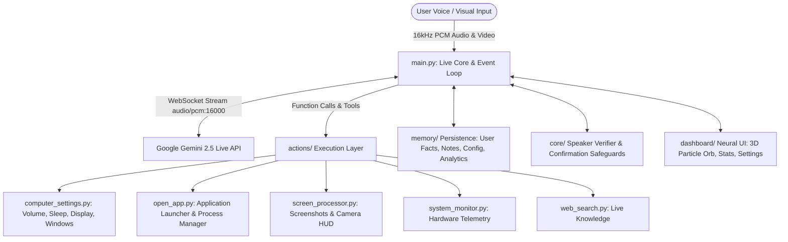

# PROJECT MJ: ARCHITECTURE & MOTIVE
**Autonomous Multimodal AI Desktop Operating Layer Powered by Google Gemini Live API**

---

## 1. Executive Summary & Core Motive

**Project MJ** is a real-time, bidirectional multimodal AI desktop operating assistant engineered to act as an autonomous, high-agency intelligence layer on top of modern personal computers. Inspired by fictional AI companions like **J.A.R.V.I.S.**, MJ transforms passive text-based AI interaction into an active, spoken, visual, and action-driven desktop companion.

### Core Motive:
> *To eliminate the friction of traditional GUI interactions and slow chatbot workflows by providing an always-listening, conversational assistant that can understand voice commands, visually inspect what is on the screen or camera, remember long-term context, and directly manipulate operating system controls without human manual effort.*

---

## 2. Key Pillars of Project MJ

1. **Sub-Second Voice Interactivity:** Immediate, human-like voice conversations with sub-300ms latency, automatic Voice Activity Detection (VAD), and instantaneous barge-in interruption capability.
2. **Native OS Execution:** Direct control over operating system functions including application opening/closing, system master volume, display brightness, full system suspend/sleep, window management, keyboard typing, and shortcuts.
3. **Multimodal Vision Grounding:** Real-time desktop screenshot capture and live camera streaming HUD for instant visual Q&A and computer vision reasoning.
4. **Long-Term Personalization:** Persistent user facts, personal preferences, quick task notes, usage statistics, and routine schedulers that remain intact across sessions.
5. **Futuristic Neural UI:** A futuristic cyberpunk Neural Dashboard with 3D fluid particle audio-reactive orb, live system metrics, settings modal, notes panel, and network self-diagnosis.

---

## 3. System Architecture & Module Breakdown

### A. Central Engine & Event Orchestration (`main.py`)
- **Gemini Live Session:** Connects via `client.aio.live.connect` to the Gemini 2.5 Flash Native Audio model.
- **Audio Input Stream:** Streams 16kHz PCM audio captured via `sounddevice.InputStream` using speech RMS energy detection and buffer overflow protection.
- **Audio Output Stream:** Receives raw PCM chunks from Gemini and streams them smoothly to the local audio output speaker.
- **Tool Calling Dispatcher:** Maintains and dispatches 21 native tool declarations, returning execution results back to the model via `types.FunctionResponse`.
- **Background Tasks:** Runs proactive morning briefings, background system resource tracking, and scheduled routine execution.

### B. Native Operating System Actions (`actions/`)
- `actions/computer_settings.py`: Controls master volume (using `pycaw` with COM `CoInitialize` safety), display brightness, `sleep_computer` (Windows `SetSuspendState`), `sleep_display`, window snapping, typing, shortcuts, and WiFi toggling.
- `actions/open_app.py`: Fuzzy application launcher that searches Windows Start Menu, UWP Apps, Registry, and system PATH to start or terminate processes.
- `actions/screen_processor.py`: Captures desktop screenshots and interfaces with the WebEngine camera stream for visual reasoning.
- `actions/system_monitor.py`: Monitors real-time CPU, RAM, Disk, Battery, Network, and GPU usage.
- `actions/web_search.py` & `knowledge_search.py`: Fetches live information from the web, real-time news, weather forecasts, and knowledge graphs.
- `Media & Productivity Modules`: Controls media playback, Spotify desktop integration, contacts, calendars, and automated recurring routines.

### C. Memory & Configuration Subsystem (`memory/`)
- `memory/memory_manager.py`: Stores user facts, persistent memories, preferences, and quick notes.
- `memory/config_manager.py`: Manages API keys, assistant name, user name, UI themes, and morning briefing settings with thread-safe file locks.
- `memory/analytics_manager.py`: Tracks total commands executed, daily tool usage patterns, and top invoked tools.
- `memory/routines_manager.py`: Schedules time-based and event-based autonomous workflows.

### D. Security & Safeguards (`core/`)
- `core/speaker_verifier.py`: Guards dangerous commands (shutdown, restart, logoff) with voice verification.
- `Confirmation Gates`: Requires explicit spoken confirmation (e.g., *"Are you sure you want to sleep the computer?"*) before executing destructive OS changes.
- `Offline Fallback Engine`: Local regex and rule-based parser handles essential commands when internet or Gemini API is offline.

### E. Neural OS Web Dashboard (`dashboard/`)
- `3D Particle Orb`: 2D Canvas particle cloud dynamically responding to microphone and speaker RMS amplitudes.
- `System Telemetry`: System telemetry HUD with real-time CPU/RAM meters and network connection health.
- `Settings Modal`: Live settings modal for Assistant Name, User Name, Color Accent Presets, System Volume Slider, and Briefing toggle.
- `Notes & Tasks`: Interactive widget for viewing, creating, and deleting quick notes and tasks.
- `Analytics Modal`: Visualizes total command counts, today actions, and breakdown charts for top tools.

---

## 4. Gemini Live Multimodal Protocol Specifications

1. **Audio Streaming:** MIME type `audio/pcm;rate=16000` dispatched continuously via `session.send_realtime_input(audio=...)`.
2. **Visual Ingestion:** Captured images sent as JPEG/PNG bytes via `session.send_realtime_input(video=...)`.
3. **Content Injection:** Structured prompt turns passed as `turns=[{"role": "user", "parts": [{"text": "..."}]}]` via `session.send_client_content`.
4. **Tool Invocation:** Function calls handled asynchronously and resolved with `types.FunctionResponse(id=fc.id, name=name, response={"result": result})`.

---

## 5. Project Vision & Future Roadmap

1. **Ambient Screen Intelligence:** Continuous on-screen context understanding to offer proactive suggestions before the user asks.
2. **Cross-Device Phone Relay:** Full synchronization between phone companion app and desktop brain.
3. **Voice Persona Customization:** Fine-tuned custom voice modeling and emotion-adaptive conversational inflection.
